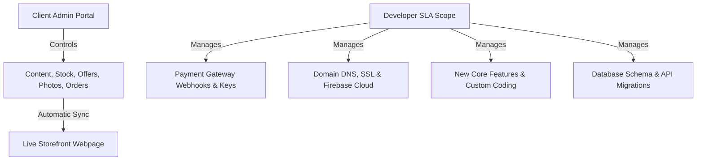

# SHIMLA CRUNCH™ | DIGITAL STOREFRONT & CMS OWNERSHIP GUIDE
### Executive Client Manual: Self-Management Capabilities & Technical SLA Matrix

---

**Client / Brand**: Shimla Crunch (4th-Gen Kotkhai Orchard & Artisanal Mountain Produce)  
**Document Code**: SC-CMS-HANDOVER-2026-V2  
**Classification**: Official Client Operations Manual  
**Technical Architecture**: Self-Hosted Vanilla Ultra-Performance Stack (Node.js + Atomic JSON + Firebase Ready)  
**Scope**: Complete demarcation of self-serve portal capabilities vs. developer-managed engineering tasks.

---

## 1. Executive Summary & Value Proposition

To eliminate recurring agency management fees and eliminate operational bottlenecks, the **Shimla Crunch Digital Storefront** has been engineered with a **zero-dependency Admin Studio**. 

As an orchard business owner, you possess **100% operational autonomy** over day-to-day commercial activities:
- You **do not** need to hire a website manager or webmaster for day-to-day operations.
- You **do not** need to wait hours or days for minor changes, price updates, or stock adjustments.
- You can upload photos directly from your phone, laptop, or camera with automatic high-speed optimization.
- You can turn marketing campaigns, coupon strips, and whole website sections ON or OFF with a single toggle switch.

> [!IMPORTANT]
> **Real-Time Live Synchronization**: Every modification made inside the Admin Portal saves instantaneously to the database and reflects immediately across customer browsers without requiring website restarts or code redeployments.

---

## 2. Quick Capability Matrix: Self-Serve vs. Developer Scope

The table below provides a quick reference guide to establish operational boundaries:

| Storefront Function | Can You Manage in Admin Portal? | Execution Time | Requires Developer? |
| :--- | :---: | :---: | :---: |
| **Live Stock & Inventory Quantities** | ✅ 100% SELF-SERVE | Immediate (< 5 sec) | ❌ No |
| **Product Selling Prices & MRP** | ✅ 100% SELF-SERVE | Immediate (< 5 sec) | ❌ No |
| **Festive Discount Strips & Coupon Codes** | ✅ 100% SELF-SERVE | Immediate (< 5 sec) | ❌ No |
| **Top Announcement Bar Message & Link** | ✅ 100% SELF-SERVE | Immediate (< 5 sec) | ❌ No |
| **Hero Banner Headlines & CTA Buttons** | ✅ 100% SELF-SERVE | Immediate (< 5 sec) | ❌ No |
| **Orchard & Product Photo Uploads** | ✅ 100% SELF-SERVE | Immediate (< 10 sec) | ❌ No |
| **Homepage Section Visibility (ON / OFF)** | ✅ 100% SELF-SERVE | Immediate (< 5 sec) | ❌ No |
| **Kotkhai Heritage Story & Terroir Copy** | ✅ 100% SELF-SERVE | Immediate (< 5 sec) | ❌ No |
| **Customer Orders, Dispatch & Tracking IDs** | ✅ 100% SELF-SERVE | Immediate (< 10 sec) | ❌ No |
| **Download Tax Invoices & CA Excel Exports** | ✅ 100% SELF-SERVE | 1-Click Export | ❌ No |
| **Customer Reviews Moderation** | ✅ 100% SELF-SERVE | Immediate (< 5 sec) | ❌ No |
| **Payment Gateway API Key Rotation** | ⚠️ TECHNICAL SCOPE | 1 – 2 Business Hours | ✅ **Yes** |
| **Courier / Logistics Webhook Integrations** | ⚠️ TECHNICAL SCOPE | 2 – 4 Business Hours | ✅ **Yes** |
| **Domain DNS, SSL Certificates & Cloud Hosting** | ⚠️ TECHNICAL SCOPE | 1 – 3 Business Hours | ✅ **Yes** |
| **Adding Brand New Product Categories / Data Models** | ⚠️ TECHNICAL SCOPE | 3 – 6 Business Hours | ✅ **Yes** |
| **Core Database Schema Migrations** | ⚠️ TECHNICAL SCOPE | 2 – 4 Business Hours | ✅ **Yes** |

---

## 3. What You Can 100% Manage Independently (In-Depth)

### 3.1. Inventory & Live Stock Adjustments
- **Real-Time Stock Counts**: Open **Admin Portal → इन्वेंट्री (Inventory)**. You can increment or decrement quantity for any SKU (e.g., set 50 units for 300g chips, or 20 units for 5kg crates).
- **Out of Stock Prevention**: When a SKU reaches `0`, the storefront automatically prevents customers from adding it to cart and displays a clean *"Sold Out — Fresh Harvest In Progress"* badge.
- **Audit Tracking**: Every stock adjustment requires a mandatory reason (e.g., *"Harvest restock batch #4"* or *"Local farm retail sale"*) which is recorded in the permanent audit trail.

### 3.2. Marketing Offers, Coupons & Marquee Banners
- **Festive 20% Offer Strip**: Under **वेबसाइट एंड कंटेंट (Website & Content)**, customize:
  - Offer Badge: e.g., *"Himalayan Harvest Festival"* or *"Diwali Special"*.
  - Coupon Code: e.g., `CRUNCH20`, `APPLELOVE`, `HIMALAYAS15`.
  - Condition Text: e.g., *"On orders above ₹1,500"*.
  - Action Button Text: e.g., *"Tap to Copy Code"*.
  - Toggle Switch: Turn the whole offer strip ON or OFF instantly.
- **Top Announcement Bar**: Update harvest updates (e.g., *"Freshly handpicked Royal Delicious dispatching today across India"*).
- **Luxury Scrolling Marquee**: Add or delete ticker items (e.g., *"Direct from Kotkhai • 7,200ft Altitude • Cold-Chain Packaging"*).

### 3.3. Visual Merchandising & Photo Uploads
- **Hero Banner Image**: Upload a new seasonal photo of your orchard or high-altitude landscape. The system automatically verifies file signatures (MIME safety), stores it securely, and updates the storefront.
- **Heritage & Terroir Photo**: Upload farm harvest pictures showing the wooden crates, sorting tables, or blossom hives.
- **No Complex Resizing Needed**: The portal handles aspect-ratio fitting and responsive scaling automatically.

### 3.4. Homepage Layout Control (Section Visibility Toggles)
You can toggle major storefront sections with zero coding:
- `[ON/OFF]` Top Announcement Bar
- `[ON/OFF]` Festive Offer Strip
- `[ON/OFF]` Featured Product Showcase
- `[ON/OFF]` Terroir Comparison Matrix (Shimla Crunch vs. Market Alternatives)
- `[ON/OFF]` 4th-Gen Kotkhai Story Section
- `[ON/OFF]` Customer Reviews & Testimonials

### 3.5. Order Management, Invoicing & CA Reports
- **Order Lifecycle**: Mark orders as `Pending` → `Processing` → `Shipped` → `Delivered`.
- **Courier Tracking Links**: Input Delhivery, Bluedart, or India Post tracking numbers. The customer can track their parcel directly.
- **1-Click GST Invoices**: Generate professional, FSSAI & GST-compliant PDF invoices for any order.
- **Accountant / CA CSV Export**: Export all monthly order records, customer tax splits, and gross sales into an Excel-ready `.csv` file.

---

## 4. Where a Developer is Required (Technical Boundaries)

To safeguard your brand against security breaches, downtime, and payment disruptions, certain low-level technical operations are deliberately isolated from the web interface. 

These operations fall under **Developer SLA Support**:

### 4.1. Payment Gateway KYC & Secret Key Configuration
- **Why a Developer is Needed**: Razorpay, Cashfree, or PhonePe require cryptographic secret keys, webhook signatures, and secure server-to-server callback endpoints. Storing raw payment secrets in an admin web form poses severe security risks.
- **When to Call Developer**: When you open a new merchant account, switch payment aggregators, or renew expired API credentials.

### 4.2. Automated Courier / Logistics API Webhooks
- **Why a Developer is Needed**: Integrating automated AWB generation (e.g., Shiprocket automated label printing, auto-calling delivery couriers) requires API authentication tokens and background cron listeners.
- **When to Call Developer**: When upgrading from manual tracking entry to fully automated automated shipping label printing.

### 4.3. Creating Entirely New Product Data Models
- **Why a Developer is Needed**: You can easily adjust existing products, stock, and descriptions. However, creating an entirely brand new product type with unique attributes (e.g., adding an interactive subscription model, perishable refrigerated cheese requiring pincode verification) requires custom UI components and cart logic.

### 4.4. Domain, SSL, DNS & Server Infrastructure
- **Why a Developer is Needed**: Managing custom domain DNS records (`A`, `CNAME`, `TXT` records for SPF/DKIM email delivery), SSL certificate renewals, and Cloudflare CDN caching configurations.
- **When to Call Developer**: When launching on a new custom domain or migrating cloud hosting regions.

### 4.5. Deep Structural Redesigns & Architectural Enhancements
- **Why a Developer is Needed**: Fundamental layout rewrites, altering the checkout payment mathematical engine, or integrating third-party ERP/CRM software (e.g., Zoho, SAP, Tally).

---

## 5. Standard Operating Procedures (SOP) for Daily Use

### SOP-01: Updating Daily Available Stock
1. Log into your Admin Portal at `yourwebsite.com/admin.html`.
2. Navigate to the **इन्वेंट्री (Inventory)** tab.
3. Locate the SKU (e.g., `CRCH-300G-01` or `APPL-ROYAL-5KG`).
4. Enter the quantity adjustment (e.g., `+25` or `-10`) and enter a brief reason (e.g., *"Fresh morning harvest batch"*).
5. Click **Adjust Stock**. The storefront updates instantly.

### SOP-02: Launching a 24-Hour Flash Sale / Festive Offer
1. Navigate to the **वेबसाइट एंड कंटेंट (Website & Content)** tab.
2. Under **Festive 20% Offer Strip**:
   - Set **Offer Badge** to: `HOLI SPECIAL` or `WEEKEND FLASH SALE`.
   - Set **Coupon Code** to: `HOLI20`.
   - Set **Condition** to: `Orders above ₹1,200`.
   - Toggle the switch to **Active (ON)**.
3. Click **Save Content**.
4. Test on the live storefront: Visit the homepage, and the golden banner will be live with 1-click coupon copy enabled.

### SOP-03: Uploading a New Hero Banner Photo
1. Navigate to **वेबसाइट एंड कंटेंट (Website & Content)**.
2. Locate the **Hero Banner & Shop Messaging** card.
3. Under **Hero Photo**, click **Choose File** and select your high-resolution orchard image (JPG, PNG, or WebP).
4. The live thumbnail will preview immediately.
5. Click **Save Content**. The new photo is immediately live on the main hero banner.

---

## 6. Security & Account Hygiene Protocol

To maintain the military-grade security implemented in the system, adhere to these simple best practices:

1. **Admin Password Confidentiality**:
   - Never share your master admin password via insecure WhatsApp messages or unencrypted emails.
   - Use a strong passphrase containing uppercase, lowercase, numbers, and symbols.
2. **Session Security**:
   - Always click **Logout** when accessing the portal from shared, hotel, or retail counter devices.
   - Sessions expire automatically after 24 hours of inactivity for safety.
3. **No Unverified Staff Access**:
   - Only authorized family members or trusted operations managers should be provided login credentials.
   - Every administrative action is permanently stamped in the audit log with IP, timestamp, and action details.

---

## 7. Developer Support & SLA Matrix

When an operation falls within the **Developer Scope**, submit a support request as follows:

| Priority Level | Scenario Examples | Response Window | Resolution Target |
| :--- | :--- | :--- | :--- |
| **Tier 1: Critical Emergency** | Payment gateway failing, site down, DNS disruption | **< 30 minutes** | **1 – 3 hours** |
| **Tier 2: High Operational** | Payment gateway credential updates, courier API sync | **< 2 hours** | **Same Day (4 – 8 hrs)** |
| **Tier 3: Standard Enhancement** | Adding new product models, custom seasonal landing page | **< 24 hours** | **1 – 3 Business Days** |
| **Tier 4: Routine Advisory** | Quarterly security audits, database backups check | **Scheduled** | **Within 5 Business Days** |

### Official Developer Support Contacts:
- **Direct Phone / WhatsApp**: `+91 8580861606`
- **Email Support**: `support@shimlacrunch.com` / `tech@shimlacrunch.com`
- **Business Hours**: 09:00 AM – 08:00 PM IST (Mon – Sat)  
- **Emergency Hotlines**: Active 24/7 for Tier 1 incidents.

---

*© 2026 Shimla Crunch™. All rights reserved. Prepared for Kotkhai Orchard Operations & Client Handover.*
